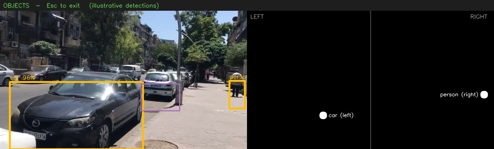

# Smart Glasses

Glasses for visually impaired people that you control with your voice, in Arabic. Say what you want, and they tell you what's around you, who is in front of you, or what a sign says.



*The helper/debug view. The detections in this picture are hand-placed to show the layout.*

## What it does

| Say | You get |
|---|---|
| **اغراض** (objects) | The three biggest objects in view (YOLOv3) and whether each is on your left or right |
| **اشخاص** (people) → **جديد** (new) | Say a name, and it learns that face |
| **اشخاص** → **قديم** (known) | Tells you who is in front of you, or that they aren't registered |
| **نصوص** (text) | Reads Arabic signs and announces landmarks like a pharmacy or clinic |
| **0** | Exit |

Input is speech and output is recorded Arabic audio, so no screen is needed.

## Run it

```bash
conda env create -f environment.yml
conda activate smart-glasses
python scripts/download_models.py      # YOLOv3 weights, ~240 MB
smart-glasses                          # or: smart-glasses --camera some_video.mp4
```

Text mode also needs `pip install ArabicOcr`. Linux audio notes and troubleshooting are in [docs/USAGE.md](docs/USAGE.md).

## Tests

```bash
pytest
```

76 tests cover the logic, the HUD and the spoken dialogue, and run in a few seconds without a camera or microphone. See [docs/TESTING.md](docs/TESTING.md).

## More

- [Usage and limitations](docs/USAGE.md)
- [Architecture and project layout](docs/ARCHITECTURE.md)
- [Performance numbers](docs/PERFORMANCE.md)
- [Testing](docs/TESTING.md)
- [Changelog (what was fixed in the refactor)](docs/CHANGELOG.md)
