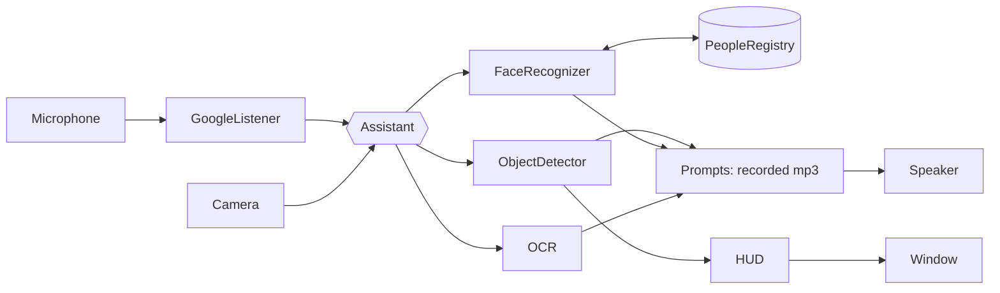

# Architecture

## Principles

1. **Hardware at the edges, logic in the middle.** Camera, microphone, speaker, window and models are all injected into `Assistant`. Nothing in the core imports `playsound`, `speech_recognition`, `gtts` or `ArabicOcr` at module level, so the package imports and tests on any machine.
2. **Pure functions for the hot path.** YOLO decoding, NMS, ranking and HUD drawing are plain functions over numpy arrays — trivial to test and benchmark.
3. **One config.** Thresholds and paths live in `config.Config` (frozen dataclass); tests override them with `dataclasses.replace`.

## Project layout

```
smart_glasses/   the package
assets/          Arabic audio prompts, COCO class list, demo video
scripts/         download_models, generate_audio, benchmark, render_preview
tests/           unit, ui, integration, perf
docs/            this folder
environment.yml  conda environment
```

## Overview



## Modules

| Module | Responsibility |
|---|---|
| `assistant.py` | The dialogue loop. `run()` listens for a command and dispatches to `objects_mode`, `people_mode`, `text_mode`; `0` exits. |
| `detection.py` | `parse_outputs` (raw YOLO rows → `Detection`), `non_max_suppression`, `largest`, `side_of`, `Announcer` (rate limiter), `ObjectDetector` (OpenCV-DNN wrapper, lazy model load). |
| `faces.py` | `largest_face`, `FaceRecognizer.register/train/identify`. Recognition votes over up to 20 frames, rejects distances above `face_max_distance`, and needs a majority. |
| `registry.py` | `PeopleRegistry`: CSV of `Name,ID`; IDs are `max+1` and never reused. |
| `ocr.py` | `find_keyword` over OCR results; `read_image` imports `ArabicOcr` lazily. |
| `hud.py` | `render` = annotated camera + radar + status bar. |
| `audio.py` | `Prompts` maps `(group, name)` → recorded mp3 and ignores missing files; `GoogleListener`; `synthesize` (gTTS). |
| `display.py` | `CvDisplay` (real window) and `ScriptedDisplay` (headless, replays key presses). |
| `bench.py` | Timing helpers and synthetic YOLO-shaped output, shared by the perf tests and `scripts/benchmark.py`. |

## Object-detection pipeline

```
frame ─► blobFromImage(320×320) ─► YOLOv3 ─► 3 output layers (6 300 rows × 85)
      ─► parse_outputs (conf > 0.3) ─► NMS (score 0.5, IoU 0.4)
      ─► largest(3) ─► side_of(frame width) ─► [(label, left|right)]
      ─► Announcer.ready()? ─► Prompts: objects/<label>.mp3 + directions/<side>.mp3
```

"Largest" is the proxy for "closest". Only three objects are announced and at most once per `announce_interval_s` (3 s) to avoid audio overload.

## Dialogue flows

```
intro ─► listen ─┬─ اغراض ─► loop frames until Esc
                 ├─ اشخاص ─► f_r ─► listen ─┬─ جديد ─► f_r1 ─► name ─► capture 20 faces ─► store ─► train ─► TTS name
                 │                          └─ قديم ─► f_r2 ─► identify ─► name mp3 | f_r3 (unknown)
                 ├─ نصوص  ─► loop frames; Space = OCR; Esc = back
                 ├─ 0     ─► end ─► return
                 └─ other ─► repeat
```

A person is only written to the registry **after** face samples were captured, so a failed enrolment leaves no ghost entries.

## Data and privacy

Runtime state is under `data/` (git-ignored): `people.csv`, `names/<id>.mp3`, `dataset/` (face crops), `recognizer.yml` (LBPH model). Nothing is uploaded except the audio sent to Google for speech recognition and the name text sent to gTTS.

## Assets

`assets/audio/objects/<coco class>.mp3` (80), `directions/{left,right}.mp3`, `ocr/<0-8>.mp3` (index into `config.OCR_KEYWORDS`), `commands/*.mp3`. `assets/coco_classes.txt` is the darknet class order — **do not reorder**, it must match the weights.
